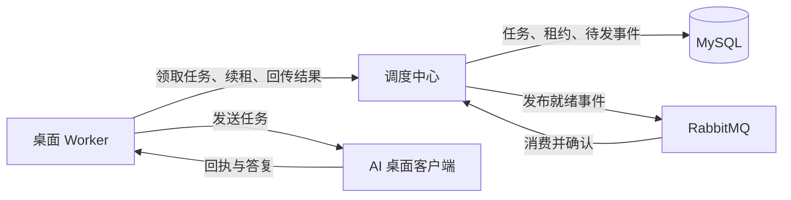

# 多客户端端到端评测平台

这套平台用于在多个 AI 桌面客户端上执行同一项评测任务。调度中心固定输入与执行版本，为每个目标客户端分配任务；桌面端负责发送、观察会话并回传结果。一次运行结束后，可以按客户端核对任务是否受理、答复是否采集、归档文件是否完整。

本仓库公开平台的架构与执行机制。评测集、运行记录和产物保存在私有环境。

## 系统架构

调度中心和 Worker 使用 TypeScript 与 Node.js 实现。MySQL 保存任务状态和资源归属，RabbitMQ 传递任务就绪通知。Worker 通过 HTTP 向中心领取任务，在 macOS 桌面上驱动对应客户端。

## 任务如何执行

1. **提交。** 中心将输入和执行版本绑定到任务。提交请求携带幂等键，调用方在响应丢失后重试，可以取回原任务。
2. **领取与发送。** Worker 领取任务和客户端资源租约，在本地记录发送意图，并在操作桌面和最终发送时检查租约是否有效。
3. **采集与归档。** Worker 将受理回执、答复和相关文件关联到本次执行。文件上传后，从中心回读并核对大小及 SHA-256 摘要。执行状态与采集完整度分别记录。

## 采集中断后如何恢复

桌面客户端可能已经接收任务，而 Worker 在回传答复前中断。此时再发送一次会创建新的客户端任务，也会让后续答复难以归属。平台依据已保存的发送意图、受理回执和检查点选择恢复路径。

| 可核对的状态 | 恢复行为 |
| --- | --- |
| 已记录发送意图，受理状态未知 | 隔离对应资源，保留原执行尝试，等待核对客户端状态。 |
| 已确认受理，结果采集不完整 | 将回执绑定到原会话，从该会话补采结果，归档到原任务。 |
| 归档已完成，调用方未收到确认 | 重复完成请求返回已有结果，保留原归档记录。 |
