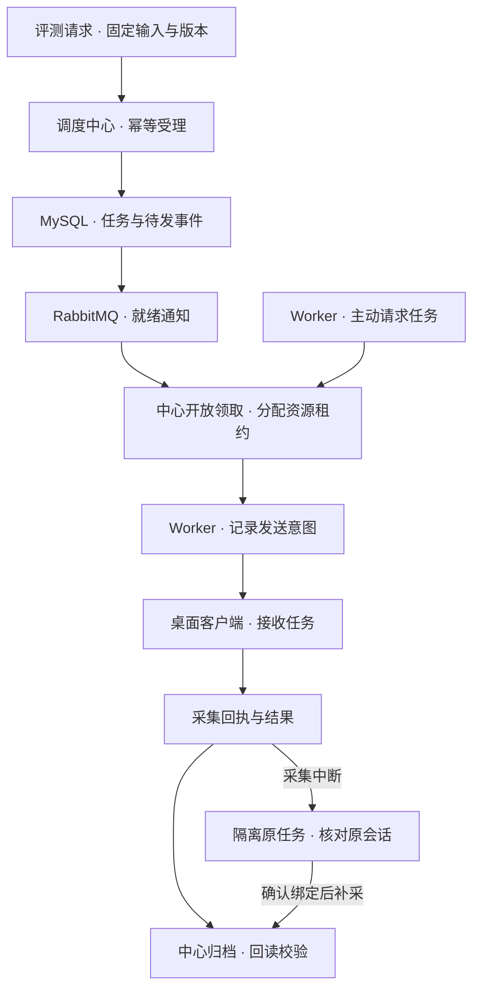

# 多客户端端到端评测平台

**一个面向 AI 桌面客户端的测试开发项目。** 我把同一份评测输入交给多个客户端执行，跟踪每次发送与受理，并把结果回收到调度中心。最难处理的是客户端已经接单、采集器却中途失联的情况：此时重跑可能造成重复提交，也会丢掉第一次执行的现场。

**技术栈**　TypeScript · Node.js · MySQL · RabbitMQ · macOS

## 我做了什么

| 工作 | 我解决的问题 | 实现思路 |
| --- | --- | --- |
| 搭建调度中心与 Worker | 提交响应丢失或队列重复投递时，同一条评测可能被执行两次。 | 中心按幂等键识别重复提交，用 MySQL 事务保存任务和待发事件，通过 RabbitMQ 通知。Worker 主动领取任务；领取响应丢失时，用原领取标识取回已有分配。 |
| 接入桌面执行 | 多个客户端共享桌面时，失联的 Worker 可能仍占用窗口。 | 为客户端资源分配有时限的租约，在桌面操作和最终发送时核验执行资格。发送前持久化意图；进程重启后若结果未知，保留现场并进入核对流程。 |
| 建立结果回收与验收流程 | 中心收到“已完成”状态，仍需要确认取回的是本次运行的结果。 | 固定输入和执行版本，分别记录受理回执、采集状态与文件清单。归档后从中心回读文件，逐项核对大小和 SHA-256；缺失的观测值保留为空。 |

## 一条任务怎样走完

我把**发送、受理、采集、归档**作为四个可单独核对的阶段。例如，客户端已有回执、中心还没有答复时，下一步是定位原会话并补采。若连受理情况都无法确认，Worker 保留发送意图和检查点，等待核对。这样排查时能区分客户端执行问题与评测平台自身的采集故障。

## 我如何验证故障路径

- **提交响应丢失。** 用相同幂等键再次提交相同内容，应取回原任务；相同键对应不同内容时，应拒绝请求。
- **发送后 Worker 重启。** 检查持久化发送意图、回执和租约。受理情况未明时，任务应进入核对流程，发送次数应保持原值。
- **恢复完成请求重复到达。** 第一次归档绑定原任务与执行尝试；重复请求应返回此前的完成结果。验收同时核对发送记录和归档文件摘要。

**数据边界**　评测集及其衍生资料仅在私有环境中使用。公开文档只描述平台架构、个人工作和通用验证方法。
