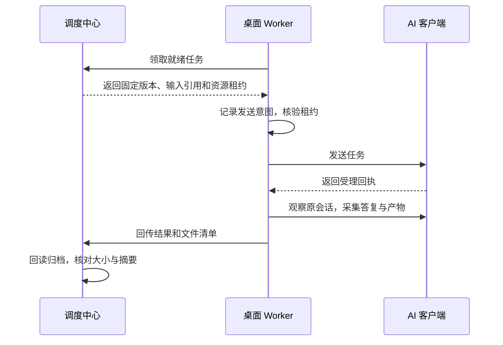

# 多客户端端到端评测平台

在 macOS 上把同一项评测任务分发给多个 AI 桌面客户端，跟踪每个客户端的受理回执，并将答复与执行产物归档到调度中心。

**平台设计文档** · TypeScript / Node.js · MySQL · RabbitMQ

评测集、原始日志和运行产物仅保存在私有环境。

## 一次评测如何执行

**调度中心**用 MySQL 事务同时保存任务和待发事件，再通过 RabbitMQ 发布就绪通知。Worker 通过 HTTP 主动领取任务。提交和领取都支持幂等重试：调用方遇到响应超时，可以凭原标识找回任务或已有分配。

**桌面 Worker** 持有目标客户端的限时租约。Worker 在发送前记录意图，并在真正操作客户端时再次核验资格。这份记录让进程重启后的恢复流程有据可查。

## 采集失败时，任务走到哪一步了？

最容易误判的情形是客户端已经受理任务，但调度中心还没有收到答复。直接重跑会创建第二个会话。平台分别记录发送、受理、采集和归档状态，据此选择恢复动作。

| 当前能确认什么 | 平台怎样处理 |
| --- | --- |
| 有发送意图，受理情况未知 | 保留原执行记录，隔离对应资源，等待核对。 |
| 已有回执，采集尚未完成 | 核对回执与原会话的绑定关系，从原会话继续采集。 |
| 中心已归档，完成确认丢失 | 重复完成请求取回已有结果，沿用原归档。 |

## 如何判断一次运行的结果

读评测记录时，可以依次回答三个问题：

1. **客户端接单了吗？** 查看受理回执，以及它与本次执行的绑定关系。
2. **答复收全了吗？** 查看采集状态、文件清单和缺失项。缺测值保留为空。
3. **归档文件与采集结果一致吗？** 从中心回读文件，逐项核对大小和 SHA-256 摘要。

这三个检查分别回答受理、采集和存储问题。答案质量由后续评估环节判断。
